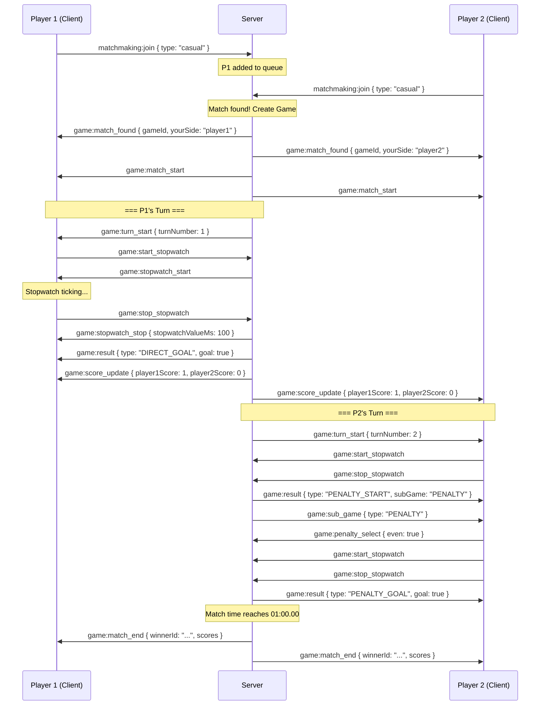
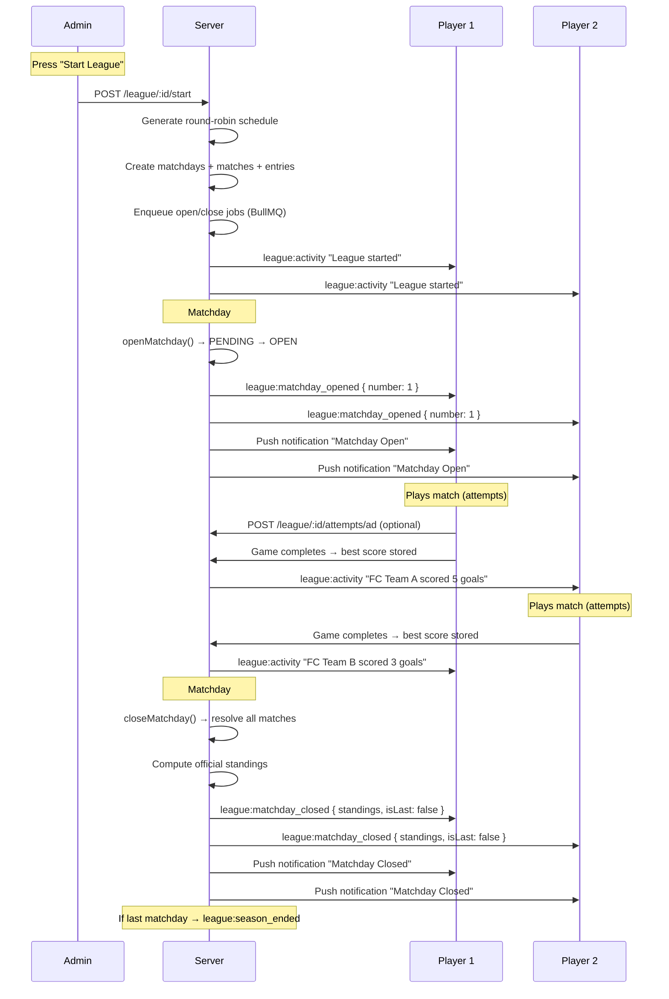

# Football Game API

Base URL: `http://localhost:3000`

- [REST Endpoints](#rest-endpoints)
  - [Auth](#auth)
  - [Ranked](#ranked)
  - [League](#league)
  - [Notifications](#notifications)
  - [Payments](#payments)
  - [Ads](#ads)
- [Socket.IO Events](#socketio-events)
  - [Matchmaking](#matchmaking)
  - [Gameplay](#gameplay)
  - [League Real-Time](#league-real-time)
- [Flows](#flows)
  - [Full Match Flow](#full-match-flow)
  - [Ranked Match Flow](#ranked-match-flow)
  - [League Matchday Flow](#league-matchday-flow)

---

## REST Endpoints

### Auth

#### `POST /api/v1/auth/signup`

Create an account. In development mode (`NODE_ENV=development`, which is the default), returns the verification link directly.

**Body:**
```json
{
  "email": "player@example.com",
  "password": "securepass123",
  "name": "Player1"
}
```

**Response (new or unverified user):**
```json
{
  "success": true,
  "message": "Account created. Please check your email to verify.",
  "data": {
    "verificationLink": "http://localhost:3000/api/v1/auth/verify-email?token=abc123...&email=player@example.com",
    "rawToken": "abc123..."
  }
}
```
> `data` is only included in development mode. In production, the generic message prevents email enumeration.

**Response (already verified):**
```json
{
  "success": false,
  "message": "Email already in use."
}
```
> Status: `409 Conflict`

---

#### `POST /api/v1/auth/login`

Authenticate and receive a JWT + session token.

**Body:**
```json
{
  "email": "player@example.com",
  "password": "securepass123"
}
```

**Response:**
```json
{
  "success": true,
  "message": "Authenticated",
  "data": {
    "token": "eyJhbGciOiJIUzI1NiIs...",
    "sessionToken": "abc123...",
    "user": {
      "id": "clx...",
      "email": "player@example.com",
      "name": "Player1"
    }
  }
}
```

Use `token` as `Bearer {{jwt_token}}` in the `Authorization` header for protected endpoints.
Use `token` as `auth.token` when connecting via Socket.IO.

---

#### `POST /api/v1/auth/verify-email`

Manually verify email with a token.

**Body:**
```json
{
  "token": "64-char-hex-from-signup",
  "email": "player@example.com"
}
```

**Response:**
```json
{
  "success": true,
  "message": "Email verified successfully."
}
```

---

#### `GET /api/v1/auth/verify-email`

Magic-link verification (click from email). Redirects to frontend.

**Query params:**
```
?token=<64-char-hex>&email=player@example.com
```

**Result:**
- Success → redirects to `{FRONTEND_URL}/login`
- Invalid/expired → redirects to `{FRONTEND_URL}/error`

---

### Ranked

#### `GET /api/v1/ranked/leaderboard`

Top 100 players by RP. Public.

**Response:**
```json
{
  "success": true,
  "message": "Leaderboard",
  "data": [
    {
      "rank": 1,
      "userId": "clx...",
      "name": "Player1",
      "division": 5,
      "divisionName": "Advanced",
      "rp": 560
    }
  ]
}
```

---

#### `GET /api/v1/ranked/season`

Current active season. Public.

**Response:**
```json
{
  "success": true,
  "message": "Active season",
  "data": {
    "id": "clx...",
    "name": "Season 1",
    "startDate": "2026-07-01T00:00:00.000Z",
    "endDate": "2026-07-31T23:59:59.000Z"
  }
}
```

---

#### `GET /api/v1/ranked/profile`

Your division, RP, promotion shield, and placement progress.

**Header:** `Authorization: Bearer {{jwt_token}}`

**Response:**
```json
{
  "success": true,
  "message": "Ranked profile",
  "data": {
    "division": 6,
    "divisionName": "Competitor",
    "rp": 450,
    "highestDivision": 5,
    "highestDivisionName": "Advanced",
    "promotionShield": 2,
    "placementMatchesPlayed": 3,
    "placementTotal": 10,
    "range": { "min": 400, "max": 499 }
  }
}
```

---

#### `GET /api/v1/ranked/history`

Last 20 matches.

**Header:** `Authorization: Bearer {{jwt_token}}`

**Response:**
```json
{
  "success": true,
  "message": "Match history",
  "data": [
    {
      "id": "clx...",
      "type": "RANKED",
      "opponent": "Player2",
      "opponentId": "clx...",
      "won": true,
      "player1Score": 3,
      "player2Score": 1,
      "endedAt": "2026-07-14T12:00:00.000Z"
    }
  ]
}
```

---

#### `GET /api/v1/ranked/stats`

Lifetime stats.

**Header:** `Authorization: Bearer {{jwt_token}}`

**Response:**
```json
{
  "success": true,
  "message": "Player stats",
  "data": {
    "gamesPlayed": 15,
    "wins": 9,
    "losses": 5,
    "draws": 1,
    "goals": 42
  }
}
```

---

### League

All `/api/v1/league/*` routes require authentication unless noted.

#### `POST /api/v1/league`

Create a new private league.

**Header:** `Authorization: Bearer {{jwt_token}}`

**Body:**
```json
{
  "name": "Premier League",
  "startDate": "2026-09-01T00:00:00.000Z",
  "matchdayStartTime": "18:00"
}
```

**Response:**
```json
{
  "success": true,
  "message": "League created",
  "data": {
    "id": "clx...",
    "name": "Premier League",
    "inviteCode": "A1B2C3D4",
    "inviteLink": "http://localhost:5173/leagues/join?code=A1B2C3D4",
    "status": "PENDING",
    "startDate": "2026-09-01T00:00:00.000Z",
    "matchdayStartTime": "18:00"
  }
}
```

---

#### `GET /api/v1/league`

List all leagues you're part of (as admin or member).

**Header:** `Authorization: Bearer {{jwt_token}}`

**Response:**
```json
{
  "success": true,
  "message": "My leagues",
  "data": [
    {
      "id": "clx...",
      "name": "Premier League",
      "status": "ACTIVE",
      "admin": { "id": "clx...", "name": "Admin" },
      "_count": { "teams": 8, "matchdays": 14 }
    }
  ]
}
```

---

#### `POST /api/v1/league/join`

Join a league via invitation code or link.

**Header:** `Authorization: Bearer {{jwt_token}}`

**Body:**
```json
{
  "code": "A1B2C3D4",
  "teamName": "FC MyTeam",
  "crestUrl": "https://example.com/crest.png"
}
```

> `crestUrl` is optional. Upload a crest later via `POST /api/v1/league/:leagueId/crest`.

**Response:**
```json
{
  "success": true,
  "message": "Joined league",
  "data": {
    "team": { "id": "clx...", "name": "FC MyTeam", "crestUrl": null },
    "league": { "id": "clx...", "name": "Premier League" }
  }
}
```

---

#### `GET /api/v1/league/:leagueId`

Get league details, your team, and admin status.

**Header:** `Authorization: Bearer {{jwt_token}}`

**Response:**
```json
{
  "success": true,
  "message": "League",
  "data": {
    "league": {
      "id": "clx...",
      "name": "Premier League",
      "status": "ACTIVE",
      "inviteCode": "A1B2C3D4",
      "inviteLink": "http://localhost:5173/leagues/join?code=A1B2C3D4",
      "admin": { "id": "clx...", "name": "Admin" },
      "_count": { "teams": 8, "matchdays": 14 }
    },
    "myTeam": { "id": "clx...", "name": "FC MyTeam", "crestUrl": null },
    "isAdmin": false
  }
}
```

---

#### `GET /api/v1/league/:leagueId/teams`

List all teams in the league.

**Header:** `Authorization: Bearer {{jwt_token}}`

**Response:**
```json
{
  "success": true,
  "message": "Teams",
  "data": [
    {
      "id": "clx...",
      "name": "FC MyTeam",
      "crestUrl": null,
      "user": { "id": "clx...", "name": "Player1" },
      "createdAt": "2026-08-01T10:00:00.000Z"
    }
  ]
}
```

---

#### `POST /api/v1/league/:leagueId/start`

Start the league (admin only). Generates the full round-robin schedule, creates all matchdays and matches, and enqueues open/close jobs.

**Header:** `Authorization: Bearer {{jwt_token}}`

**Response:**
```json
{
  "success": true,
  "message": "League started",
  "data": {
    "league": { "id": "clx...", "name": "Premier League", "status": "ACTIVE" },
    "matchdays": [
      {
        "number": 1,
        "opensAt": "2026-09-01T18:00:00.000Z",
        "closesAt": "2026-09-02T18:00:00.000Z",
        "byeTeamId": null
      }
    ]
  }
}
```

---

#### `GET /api/v1/league/:leagueId/standings`

Get league standings. Pass `?live=true` for provisional real-time standings during an open matchday.

**Header:** `Authorization: Bearer {{jwt_token}}`

**Response:**
```json
{
  "success": true,
  "message": "Standings",
  "data": {
    "official": [
      {
        "position": 1,
        "teamId": "clx...",
        "teamName": "FC MyTeam",
        "crestUrl": null,
        "played": 5,
        "wins": 3,
        "draws": 1,
        "losses": 1,
        "goalsFor": 12,
        "goalsAgainst": 6,
        "goalDifference": 6,
        "points": 10
      }
    ],
    "provisional": null
  }
}
```

> When `?live=true` and a matchday is open, `provisional` contains live standings based on current best scores.

---

#### `GET /api/v1/league/:leagueId/schedule`

Get the full season schedule with all matchdays and matches.

**Header:** `Authorization: Bearer {{jwt_token}}`

**Response:**
```json
{
  "success": true,
  "message": "Schedule",
  "data": [
    {
      "id": "clx...",
      "number": 1,
      "opensAt": "2026-09-01T18:00:00.000Z",
      "closesAt": "2026-09-02T18:00:00.000Z",
      "status": "CLOSED",
      "matches": [
        {
          "id": "clx...",
          "homeTeam": { "id": "clx...", "name": "FC Team A", "crestUrl": null },
          "awayTeam": { "id": "clx...", "name": "FC Team B", "crestUrl": null },
          "status": "FINISHED",
          "homeGoals": 3,
          "awayGoals": 1,
          "winnerTeamId": "clx..."
        }
      ]
    }
  ]
}
```

---

#### `GET /api/v1/league/:leagueId/current`

Get current matchday, next match, and your attempt status.

**Header:** `Authorization: Bearer {{jwt_token}}`

**Response:**
```json
{
  "success": true,
  "message": "Current matchday",
  "data": {
    "current": {
      "id": "clx...",
      "number": 3,
      "opensAt": "2026-09-03T18:00:00.000Z",
      "closesAt": "2026-09-04T18:00:00.000Z",
      "countdownMs": 0,
      "closesInMs": 43200000
    },
    "next": {
      "id": "clx...",
      "number": 4,
      "opensAt": "2026-09-05T18:00:00.000Z",
      "closesAt": "2026-09-06T18:00:00.000Z",
      "countdownMs": 172800000
    },
    "myNextMatch": {
      "matchdayNumber": 4,
      "opponent": {
        "id": "clx...",
        "name": "FC Rival",
        "crestUrl": null
      },
      "opensAt": "2026-09-05T18:00:00.000Z",
      "countdownMs": 172800000
    },
    "myEntry": {
      "used": 2,
      "total": 3,
      "remaining": 1,
      "freeLeft": 0,
      "adLeft": 1,
      "purchasedLeft": 0,
      "bestGoals": 5,
      "activeGameId": null
    },
    "pricing": {
      "freeAttempts": 2,
      "adAttempts": 1,
      "packSize": 2,
      "packPriceCents": 100
    }
  }
}
```

---

#### `GET /api/v1/league/:leagueId/matchday-live`

Live view of all matches in the current open matchday (Matchday Live UI).

**Header:** `Authorization: Bearer {{jwt_token}}`

**Response:**
```json
{
  "success": true,
  "message": "Matchday live",
  "data": {
    "matchday": {
      "id": "clx...",
      "number": 3,
      "opensAt": "2026-09-03T18:00:00.000Z",
      "closesAt": "2026-09-04T18:00:00.000Z",
      "status": "OPEN"
    },
    "matches": [
      {
        "id": "clx...",
        "home": { "id": "clx...", "name": "FC Team A", "crestUrl": null },
        "away": { "id": "clx...", "name": "FC Team B", "crestUrl": null },
        "status": "IN_PLAY",
        "homeBest": 4,
        "awayBest": 3,
        "provisionalResult": { "homeGoals": 4, "awayGoals": 3 },
        "homeAttemptsUsed": 2,
        "awayAttemptsUsed": 1
      }
    ]
  }
}
```

> Match statuses: `PENDING`, `IN_PLAY`, `FINISHED`

---

#### `GET /api/v1/league/:leagueId/matchdays/:number`

Full matchday detail with complete attempt history for both players.

**Header:** `Authorization: Bearer {{jwt_token}}`

**Response:**
```json
{
  "success": true,
  "message": "Matchday",
  "data": {
    "matchday": { "id": "clx...", "number": 3, "status": "CLOSED" },
    "matches": [
      {
        "id": "clx...",
        "home": { "id": "clx...", "name": "FC Team A", "crestUrl": null },
        "away": { "id": "clx...", "name": "FC Team B", "crestUrl": null },
        "status": "FINISHED",
        "homeBest": 5,
        "awayBest": 3,
        "homeAttemptsUsed": 3,
        "awayAttemptsUsed": 2,
        "homeLastAttemptAt": "2026-09-03T20:15:00.000Z",
        "awayLastAttemptAt": "2026-09-03T19:30:00.000Z",
        "officialHomeGoals": 5,
        "officialAwayGoals": 3,
        "winnerTeamId": "clx...",
        "history": [
          { "teamId": "clx...", "attemptNumber": 1, "goals": 3, "at": "2026-09-03T18:30:00.000Z" },
          { "teamId": "clx...", "attemptNumber": 2, "goals": 5, "at": "2026-09-03T20:15:00.000Z" }
        ]
      }
    ]
  }
}
```

---

#### `POST /api/v1/league/:leagueId/attempts/ad`

Claim 1 additional attempt by watching a rewarded ad (once per matchday).

**Header:** `Authorization: Bearer {{jwt_token}}`

**Response:**
```json
{
  "success": true,
  "message": "Ad attempt granted",
  "data": {
    "adGranted": true,
    "attemptsLeft": 3
  }
}
```

---

#### `POST /api/v1/league/:leagueId/attempts/purchase`

Purchase an additional attempt pack. If Stripe is configured, returns a checkout URL. If not, grants immediately (dev mode).

> Pass `?redirect=true` (or body `{ "redirect": true }`) to be redirected (`303`) straight to the Stripe checkout URL instead of receiving JSON. A GET request redirects by default (use `?redirect=false` for JSON).

**Header:** `Authorization: Bearer {{jwt_token}}`

**Response (with Stripe):**
```json
{
  "success": true,
  "message": "Attempt pack purchased",
  "data": {
    "requiresPayment": true,
    "checkoutUrl": "https://checkout.stripe.com/...",
    "sessionId": "cs_...",
    "packSize": 2,
    "priceCents": 100
  }
}
```

**Response (dev mode):**
```json
{
  "success": true,
  "message": "Attempt pack purchased",
  "data": {
    "requiresPayment": false,
    "purchased": 2,
    "priceCents": 100,
    "totalAttemptsLeft": 5
  }
}
```

---

#### `POST /api/v1/league/:leagueId/attempts/start`

Start a new attempt during an open matchday. Consumes one attempt (free → ad → purchased order), creates the attempt and its game, and returns the IDs used by the hit APIs.

**Header:** `Authorization: Bearer {{jwt_token}}`

**Response:**
```json
{
  "success": true,
  "message": "Attempt started",
  "data": {
    "attemptId": "cmt...",
    "gameId": "cmt...",
    "matchId": "cmt...",
    "attemptNumber": 2,
    "matchdayNumber": 3,
    "attemptsUsed": 2,
    "remainingAttempts": 1,
    "bestGoals": 4
  }
}
```

---

#### `POST /api/v1/league/:leagueId/attempts/hit`

Called by the client on **every ball hit** during an attempt. The stopwatch value is evaluated server-side: on goal the attempt score, game score and matchday best are updated. When the hit is a goal, `canSaveGoal: true` is returned so the frontend can show the **Save** button and call the Goal Save API.

**Header:** `Authorization: Bearer {{jwt_token}}`

**Body:**
| Field | Type | Required | Description |
|---|---|---|---|
| `stopwatchValueMs` | number | yes | Stopwatch value in ms when the ball was hit |
| `gameId` | string | no | Game id (falls back to active game) |
| `attemptId` | string | no | Attempt id (falls back to latest attempt) |
| `turnNumber` | number | no | Turn number in the game |

**Response:**
```json
{
  "success": true,
  "message": "Hit recorded",
  "data": {
    "eventType": "DIRECT_GOAL",
    "goal": true,
    "stopwatchValueMs": 12345,
    "currentScore": 3,
    "subGame": null,
    "bestGoals": 4,
    "attemptId": "cmt...",
    "gameId": "cmt...",
    "matchId": "cmt...",
    "leagueId": "cmt...",
    "teamId": "cmt...",
    "scoringTeamId": "cmt...",
    "opponentTeamId": "cmt...",
    "scoringPlayerId": "cmt...",
    "canSaveGoal": true
  }
}
```

> If `subGame` is non-null (`FREE_KICK`, `PENALTY` or `CORNER`), play the sub-game next and report it via `/attempts/sub-hit`.

---

#### `POST /api/v1/league/:leagueId/attempts/sub-hit`

Record the result of a sub-game (free kick / penalty / corner) selected after a hit.

**Header:** `Authorization: Bearer {{jwt_token}}`

**Body:**
| Field | Type | Required | Description |
|---|---|---|---|
| `subGameType` | string | yes | `FREE_KICK`, `PENALTY` or `CORNER` |
| `selection` | string \| number \| boolean | yes | The player's selection in the sub-game |
| `stopwatchValueMs` | number | yes | Stopwatch value in ms |
| `gameId` | string | no | Game id |
| `attemptId` | string | no | Attempt id |
| `turnNumber` | number | no | Turn number |

**Response:** same shape as `/attempts/hit`.

---

#### `POST /api/v1/league/:leagueId/attempts/finish`

Finish the current attempt. Marks the game as finished and updates the best score for the matchday.

**Header:** `Authorization: Bearer {{jwt_token}}`

**Body:**
| Field | Type | Required | Description |
|---|---|---|---|
| `goals` | number | no | Final goals of this attempt (defaults to recorded goals) |
| `gameId` | string | no | Game id |
| `attemptId` | string | no | Attempt id |

**Response:**
```json
{
  "success": true,
  "message": "Attempt finished",
  "data": {
    "attemptId": "cmt...",
    "gameId": "cmt...",
    "goals": 3,
    "bestGoals": 4,
    "attemptNumber": 2,
    "matchdayNumber": 3
  }
}
```

---

#### `GET /api/v1/league/:leagueId/attempts/history`

Get all attempts of my team in this league. Optional query `?matchday=3` filters by matchday number.

**Header:** `Authorization: Bearer {{jwt_token}}`

**Response:**
```json
{
  "success": true,
  "message": "Attempt history",
  "data": [
    {
      "id": "cmt...",
      "attemptNumber": 1,
      "goals": 2,
      "matchdayNumber": 3,
      "createdAt": "2026-08-23T10:00:00.000Z"
    }
  ]
}
```

---

### League Goal Saving

#### `POST /api/v1/league/:leagueId/goals/save`

Save a goal scored during an attempt. Called by the frontend when the user taps **Save** after achieving a goal (`canSaveGoal: true` from `/attempts/hit`).

Most context fields are optional — they are auto-resolved from `attemptId` or from your team + the open matchday. Duplicate submissions for the same attempt/stopwatch/event are detected and returned with `alreadySaved: true`.

When connected to a league match, the goal updates the official match score (`homeGoals` / `awayGoals`) and the winner — standings reflect these goals.

**Header:** `Authorization: Bearer {{jwt_token}}`

**Body (all optional):**
| Field | Type | Description |
|---|---|---|
| `matchdayId` | string | Matchday id (auto-resolved) |
| `matchId` | string | Match id (auto-resolved) |
| `gameId` | string | Game id |
| `attemptId` | string | Attempt id (auto-resolves match/team/opponent) |
| `scoringTeamId` | string | Defaults to my team |
| `opponentTeamId` | string | Auto-resolved from the match |
| `scoringPlayerId` | string | Defaults to current user |
| `clientGoalId` | string | Client-side idempotency key |
| `eventType` | string | `DIRECT_GOAL`, `FREE_KICK_GOAL`, `PENALTY_GOAL`, `CORNER_GOAL`, ... (default `DIRECT_GOAL`) |
| `stopwatchValueMs` | number | Stopwatch value at the goal |
| `score` | number | Goals to add (default `1`) |
| `metadata` | object | Extra data stored with the goal |

**Response:**
```json
{
  "success": true,
  "message": "Goal saved successfully",
  "data": {
    "id": "cmt...",
    "userId": "cmt...",
    "leagueId": "cmt...",
    "matchdayId": "cmt...",
    "matchId": "cmt...",
    "attemptId": "cmt...",
    "scoringTeamId": "cmt...",
    "opponentTeamId": "cmt...",
    "eventType": "DIRECT_GOAL",
    "score": 1,
    "alreadySaved": false,
    "matchResult": {
      "matchId": "cmt...",
      "homeTeamId": "cmt...",
      "awayTeamId": "cmt...",
      "homeGoals": 2,
      "awayGoals": 1,
      "winnerTeamId": "cmt...",
      "status": "IN_PLAY",
      "isDraw": false
    }
  }
}
```

Also available without the league prefix: `POST /api/v1/goals/save` (pass `leagueId` in body).

---

#### `GET /api/v1/league/:leagueId/goals/saved`

List my saved goals in this league.

**Header:** `Authorization: Bearer {{jwt_token}}`

**Response:** array of saved goal objects as above (without `matchResult`).

---

#### `DELETE /api/v1/league/:leagueId/goals/:goalId`

Delete one of my saved goals.

**Header:** `Authorization: Bearer {{jwt_token}}`

**Response:**
```json
{
  "success": true,
  "message": "Saved goal removed",
  "data": { "id": "cmt...", "deleted": true }
}
```

---

#### `POST /api/v1/league/:leagueId/crest`

Upload a team crest image.

**Header:** `Authorization: Bearer {{jwt_token}}`
**Content-Type:** `multipart/form-data`

**Form data:**
| Key | Type | Description |
|---|---|---|
| `crest` | file | Image file (JPEG, PNG, GIF, WebP, SVG). Max 2MB. |

**Response:**
```json
{
  "success": true,
  "message": "Crest uploaded",
  "data": {
    "crestUrl": "/public/uploads/crests/1691234567890-a1b2c3d4e5f6.png"
  }
}
```

---

#### `GET /api/v1/league/config`

Get league configuration (admin only).

**Header:** `Authorization: Bearer {{jwt_token}}`

**Response:**
```json
{
  "success": true,
  "message": "League config",
  "data": {
    "freeAttempts": 2,
    "adAttempts": 1,
    "packSize": 2,
    "packPriceCents": 100,
    "matchdayHours": 24
  }
}
```

---

#### `PUT /api/v1/league/config`

Update league configuration (admin only).

**Header:** `Authorization: Bearer {{jwt_token}}`

**Body (all fields optional):**
```json
{
  "freeAttempts": 3,
  "adAttempts": 1,
  "packSize": 2,
  "packPriceCents": 150,
  "matchdayHours": 24
}
```

**Response:**
```json
{
  "success": true,
  "message": "League config updated",
  "data": {
    "id": "default",
    "freeAttempts": 3,
    "adAttempts": 1,
    "packSize": 2,
    "packPriceCents": 150,
    "matchdayHours": 24
  }
}
```

---

### Notifications

All `/api/v1/notifications/*` routes require authentication.

#### `GET /api/v1/notifications`

List your notifications. Pass `?unread=true` for unread only.

**Header:** `Authorization: Bearer {{jwt_token}}`

**Response:**
```json
{
  "success": true,
  "message": "Notifications",
  "data": [
    {
      "id": "clx...",
      "title": "Matchday Open",
      "body": "Matchday #3 of Premier League is now open!",
      "type": "matchday_opened",
      "data": { "leagueId": "clx...", "matchdayNumber": 3 },
      "read": false,
      "createdAt": "2026-09-03T18:00:00.000Z"
    }
  ]
}
```

> Notification types: `matchday_opened`, `matchday_closed`, `season_ended`, `league_started`, `attempt_purchased`, `ad_reward_granted`, `match_result`, `general`

---

#### `GET /api/v1/notifications/unread-count`

Get the count of unread notifications.

**Header:** `Authorization: Bearer {{jwt_token}}`

**Response:**
```json
{
  "success": true,
  "message": "Unread count",
  "data": { "count": 3 }
}
```

---

#### `POST /api/v1/notifications/read/:notificationId`

Mark a notification as read.

**Header:** `Authorization: Bearer {{jwt_token}}`

**Response:**
```json
{
  "success": true,
  "message": "Marked as read"
}
```

---

#### `POST /api/v1/notifications/read-all`

Mark all notifications as read.

**Header:** `Authorization: Bearer {{jwt_token}}`

**Response:**
```json
{
  "success": true,
  "message": "All notifications marked as read"
}
```

---

#### `POST /api/v1/notifications/device-token`

Register a push notification device token.

**Header:** `Authorization: Bearer {{jwt_token}}`

**Body:**
```json
{
  "token": "fcm-device-token-or-apns-token",
  "platform": "android"
}
```

> Platforms: `ios`, `android`, `web`

**Response:**
```json
{
  "success": true,
  "message": "Device token registered"
}
```

---

#### `DELETE /api/v1/notifications/device-token`

Remove a device token (e.g. on logout).

**Header:** `Authorization: Bearer {{jwt_token}}`

**Body:**
```json
{
  "token": "fcm-device-token-or-apns-token"
}
```

**Response:**
```json
{
  "success": true,
  "message": "Device token removed"
}
```

---

### Payments

All `/api/v1/payments/*` routes require authentication (except webhook).

#### `POST /api/v1/payments/checkout`

Create a Stripe checkout session for purchasing attempt packs. Pack size and price come from league config.

> Pass `?redirect=true` (or body `{ "redirect": true }`) to be redirected (`303`) directly to the Stripe checkout URL instead of receiving JSON.

**Header:** `Authorization: Bearer {{jwt_token}}`

**Body:**
```json
{
  "leagueId": "clx..."
}
```

**Response:**
```json
{
  "success": true,
  "message": "Checkout session created",
  "data": {
    "sessionId": "cs_...",
    "url": "https://checkout.stripe.com/pay/cs_...",
    "checkoutUrl": "https://checkout.stripe.com/pay/cs_...",
    "requiresPayment": true,
    "packSize": 2,
    "priceCents": 100
  }
}
```

---

#### `GET /api/v1/payments/checkout`

Browser-friendly variant: creates a checkout session and **redirects (`303`) straight to Stripe**. Auth via `Authorization` header or `?token={{jwt_token}}`. Requires `?leagueId=`.

Use `?redirect=false` to get JSON instead of redirecting.

> Redirect the user to `url` to complete payment. Stripe webhook at `POST /api/v1/payments/webhook` handles fulfillment.

---

#### `POST /api/v1/payments/webhook`

Stripe webhook endpoint. Called by Stripe servers, not by clients.

**Header:** `Stripe-Signature: whsec_...`
**Content-Type:** `application/json` (raw body)

**Response:**
```json
{ "received": true }
```

---

### Ads

All `/api/v1/ads/*` routes require authentication.

#### `POST /api/v1/ads/verify`

Verify a rewarded ad impression and grant an attempt.

**Header:** `Authorization: Bearer {{jwt_token}}`

**Body:**
```json
{
  "leagueId": "clx...",
  "adProvider": "admob",
  "adImpressionId": "imp-abc123"
}
```

**Response:**
```json
{
  "success": true,
  "message": "Ad reward granted",
  "data": {
    "adGranted": true,
    "attemptsLeft": 3
  }
}
```

---

## Socket.IO Events

Connect to `http://localhost:3000` with Socket.IO client (v4).

**Auth:**
```js
const socket = io("http://localhost:3000", {
  auth: { token: "<jwt_token>" }
});
```

All events are namespaced under the default `/` namespace.

### Matchmaking

#### Client → Server

| Event | Payload | Description |
|---|---|---|
| `matchmaking:join` | `{ type: "casual" \| "ranked" }` | Join matchmaking queue |
| `matchmaking:leave` | — | Leave matchmaking queue |

#### Server → Client

| Event | Payload | Description |
|---|---|---|
| `matchmaking:error` | `{ message: string }` | Matchmaking failed |
| `game:match_found` | `{ gameId, opponentId, yourSide }` | Opponent found, game starting |
| `game:match_start` | `{ gameId, player1, player2 }` | Match has begun |

### Gameplay

All gameplay events are server-authoritative. The server generates the random stopwatch values and evaluates outcomes.

#### Client → Server

| Event | Payload | When |
|---|---|---|
| `game:start_stopwatch` | — | Your turn, tap the ball to start |
| `game:stop_stopwatch` | — | Tap again to stop |
| `game:free_kick_select` | `{ digit: 0-9 }` | Free kick: choose a digit |
| `game:penalty_select` | `{ even: boolean }` | Penalty: pick even (`true`) or odd (`false`) |
| `game:corner_select` | `{ digits: 0-99 }` | Corner: guess last two digits |
| `game:sub_stopwatch_stop` | — | Stop the sub-game stopwatch |

#### Server → Client

| Event | Payload | Description |
|---|---|---|
| `game:state` | `{ phase, currentTurn, turnNumber, ... }` | Full game state update |
| `game:turn_start` | `{ turnNumber }` | Your turn — tap the ball |
| `game:stopwatch_start` | `{ turnNumber, startTime }` | Stopwatch is ticking |
| `game:stopwatch_stop` | `{ turnNumber, stopwatchValueMs }` | Stopwatch stopped at value |
| `game:result` | `{ type, stopwatchValueMs, goal, subGame? }` | Outcome of your action |
| `game:sub_game` | `{ type: "FREE_KICK" \| "PENALTY" \| "CORNER" }` | Sub-game mode activated |
| `game:score_update` | `{ player1Score, player2Score }` | Score changed |
| `game:match_clock` | `{ elapsed, totalTime, stoppageTimeMs }` | Match timer tick (every 100ms) |
| `game:match_end` | `{ winnerId, player1Score, player2Score }` | Match over |

**`game:result.type` values:**

| Type | Means |
|---|---|
| `DIRECT_GOAL` | Goal scored (stopwatch ended in .00) |
| `FREE_KICK_START` | Free kick awarded (sub-game begins) |
| `FREE_KICK_GOAL` | Free kick scored |
| `FREE_KICK_MISS` | Free kick missed |
| `PENALTY_START` | Penalty awarded (sub-game begins) |
| `PENALTY_GOAL` | Penalty scored |
| `PENALTY_MISS` | Penalty missed |
| `CORNER_START` | Corner awarded (sub-game begins) |
| `CORNER_GOAL` | Corner scored |
| `CORNER_MISS` | Corner cleared |
| `SAVE` | Shot saved or missed |

### League Real-Time

Join a league room to receive live updates for matchday events and activity feeds.

#### Client → Server

| Event | Payload | Description |
|---|---|---|
| `league:join` | `{ leagueId: string }` | Join a league's real-time room |
| `league:leave` | `{ leagueId: string }` | Leave a league's real-time room |

#### Server → Client

| Event | Payload | Description |
|---|---|---|
| `league:matchday_opened` | `{ matchdayId, number, opensAt, closesAt }` | A new matchday has started |
| `league:matchday_closed` | `{ matchdayId, number, standings[], isLast }` | Matchday ended, standings updated |
| `league:season_ended` | `{ champion: { teamId, position, points } }` | Season complete, champion crowned |
| `league:activity` | `{ text, at, ...extra }` | Live activity feed event |
| `league:error` | `{ message: string }` | Error joining/leaving league |

**`league:activity` example payloads:**

| Text | Context |
|---|---|
| `"FC Pablo just scored 12 goals"` | Player completed an attempt |
| `"FC Ernesto overtakes FC Pablo"` | Standings position changed |
| `"FC Carlos has utilized an additional attempt"` | Player bought/watched ad |
| `"FC Alvaro has finished their participation"` | Player used all attempts |

---

## Flows

### Full Match Flow



### Ranked Match Flow

Same as casual, but after `game:match_end` the server also updates RP, division, and promotion shield. Players can view the result via `GET /api/v1/ranked/profile`.

**RP rules:**
| Scenario | Winner RP | Loser RP |
|---|---|---|
| Same division | +25 | -20 |
| Winner is lower division | +30 | -15 |
| Winner is higher division | +20 | -25 |
| Placement match | +25–40 | 0 |

**Divisions:**
| # | Name | RP Range |
|---|---|---|
| 10 | Rookie | 0–99 |
| 9 | Beginner | 100–199 |
| 8 | Novice | 200–299 |
| 7 | Amateur | 300–399 |
| 6 | Competitor | 400–499 |
| 5 | Advanced | 500–599 |
| 4 | Expert | 600–699 |
| 3 | Professional | 700–799 |
| 2 | Champion | 800–899 |
| 1 | Legend | 900–999 |

### League Matchday Flow



**Points system:**
| Result | Points |
|---|---|
| Win | 3 |
| Draw | 1 |
| Loss | 0 |

**Inactivity rules:**
| Scenario | Result |
|---|---|
| One player doesn't play | 0-3 loss, opponent gets 3 pts |
| Neither player plays | Both get 0-3 loss, 0 pts |

**Tiebreaker order:**
1. Head-to-head goal difference
2. Overall goal difference
